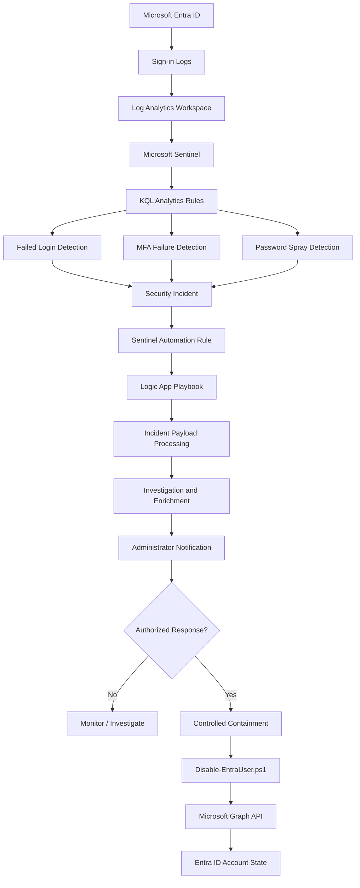

# Architecture – Microsoft Sentinel Entra ID Failed Login Protection

## 1. Overview

This template collection demonstrates a security monitoring and response workflow built around Microsoft Entra ID and Microsoft Sentinel.
Its primary objective is to identify suspicious authentication activity, correlate failed sign-in patterns, generate security incidents, and provide a controlled response mechanism for investigating potentially compromised accounts.
The architecture follows three distinct security stages:

1. **Detection** – Identify suspicious authentication patterns using Microsoft Sentinel and Kusto Query Language (KQL).
2. **Investigation** – Enrich and analyze generated incidents to establish whether activity is malicious.
3. **Response** – Notify administrators and, when explicitly authorized, perform account containment actions through Microsoft Graph PowerShell.

The design intentionally separates detection from containment. A failed sign-in is not sufficient evidence that an account is compromised.

## 2. Architecture Diagram

## 3. Core Components

### 3.1 Microsoft Entra ID

Microsoft Entra ID is the identity provider and source of authentication telemetry.

The project uses sign-in activity to identify patterns such as:

- Repeated failed authentication attempts.
- Repeated MFA-related failures.
- Multiple user accounts targeted from a single IP address.

Relevant telemetry is collected from the `SigninLogs` table.

The detection queries use the sign-in result, timestamp, user principal name, IP address, application, and authentication-related fields.

### 3.2 Log Analytics Workspace

The Log Analytics workspace stores the sign-in telemetry consumed by Microsoft Sentinel.

The Entra ID diagnostic settings must be configured to send the appropriate sign-in logs to the workspace.

The workspace acts as the data layer for KQL-based detection and investigation.

### 3.3 Microsoft Sentinel

Microsoft Sentinel provides the SIEM capabilities used by this project.

It is responsible for:

- Running scheduled analytics rules.
- Identifying suspicious authentication patterns.
- Creating and managing security incidents.
- Triggering automation workflows.
- Supporting incident investigation and response.

### 3.4 KQL Detection Rules

The `queries/` directory contains three initial detection queries.

| Query | Detection objective |
|---|---|
| `entra-failed-login-audit.kql` | Detect repeated failed sign-ins against an individual account. |
| `entra-mfa-failure-audit.kql` | Detect repeated failed sign-ins associated with MFA requirements. |
| `entra-password-spray.kql` | Identify one IP address targeting multiple user accounts. |

The queries use configurable time windows and thresholds.

These values are initial tuning parameters, not universal indicators of compromise.

Detection limitations:

- Failed sign-ins can result from legitimate user mistakes, expired credentials, application misconfiguration, or other authentication failures.
- MFA-related failures require additional investigation to distinguish ordinary authentication problems from MFA fatigue or abuse.
- Password-spray detection can be affected by shared NAT addresses, VPN gateways, proxies, and legitimate automated authentication.
- Detection results should be tuned against the actual environment before being used for operational alerting.

### 3.5 Sentinel Analytics Rules

The `analytics-rules/` directory contains the configuration representation for scheduled detection rules.

The intended configuration includes:

- KQL query.
- Query execution frequency.
- Query lookback period.
- Alert severity.
- Entity mappings.
- Incident creation settings.
- MITRE ATT&CK mappings where applicable.

The analytics rules convert query results into alerts and incidents.

**Implementation status:** The current YAML file is a configuration draft. It must be converted or validated against the actual Sentinel deployment schema before deployment.

### 3.6 Sentinel Automation Rules

The `automation-rules/` directory contains the intended automation configuration.

Automation rules connect Sentinel incidents with playbooks and can be used to:

- Trigger a playbook when an incident is created.
- Apply conditions to determine which incidents qualify.
- Initiate investigation and notification workflows.

Automation rules are orchestration mechanisms. They do not independently establish that an account is compromised.

**Implementation status:** The current YAML file is a design draft, not a verified deployment artifact.

### 3.7 Logic App Playbook

The `playbooks/Entra-FailedLogin-Response/` directory contains the Logic App deployment
